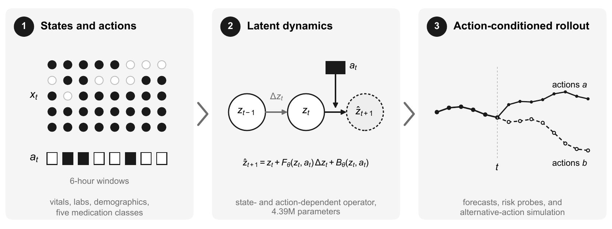

# EHR World Model

<p align="center">
  <a href="assets/hero.pdf"></a>
</p>

EHR-WM is an action-conditioned latent world model for ICU and hospital EHR trajectories.
Patient state (vitals, labs, demographics) is binned into 6-hour windows. Five classes of
clinical action (antibiotics, IV fluids, vasopressors, analgesics, sedatives) enter the latent
transition operator directly:

    z_{t+1} = z_t + F(z_t, a_t) Δz_t + B(z_t, a_t),    B(z, 0) = 0

The model is trained separately on MIMIC-IV, eICU-CRD and NWICU. It is evaluated on latent
trajectory fidelity, forecasting of clinical measurements, downstream classification and
time-to-event prediction, and matched-cohort intervention analyses.

## Layout

```
ehr_world_model/            core model and MEDS utilities
  models/world_model.py     EHRWorldModel: encoder, velocity operator F(z, a), SIGReg + reconstruction losses
  sigreg.py                 Fourier Epps-Pulley SIGReg regulariser
  inference.py              model construction, checkpoint save / load
  features.py, config.py    MEDS code classification and the 78-code medication manifest
  labels.py, cohort.py      MEDS loader, demographics, disease flags and in-hospital outcome labels
experiments/                data preprocessing, training and every experiment
  actions.py                5 clinical action groups (drug-name lexicon, ICU fluid itemids, ATC rules)
  features.py               42 curated state concepts (itemid merges, plausibility ranges, log transforms)
  data.py                   MIMIC-IV MEDS -> processed 6-h timelines (Split, WindowDataset)
  xsite.py                  the same features / actions for harmonised MIMIC-IV, eICU-CRD and NWICU extracts
  models.py                 AdditiveActionEHRWorldModel: adds the action forcing term B(z, a)
  train.py                  model specs, scheduled-sampling curriculum, checkpoints
  evaluate.py               encoding, free rollout, downstream probe benchmark
  run_site.py               per-(site, model) driver: benchmark, discriminators, risk trajectories, RCT
  forecast_h.py             feature-space forecasting at 6-48 h horizons vs baselines
  forecast_models.py        GRU-D, Latent ODE and Transformer forecasting baselines
  inpatient.py              48-h inpatient classification and time-to-event tasks
  baselines_surv.py         CoxPH, DeepSurv and DeepHit baselines
  xgb_baselines.py          XGBoost baselines
  rct.py                    emulated-RCT evaluation of action conditioning
  action_analysis.py        action specificity and physiological validation
  traj_ablation.py          direct vs trajectory-based prediction
```

## Setup

```bash
pip install -r requirements.txt
```

The data is not included. MIMIC-IV, eICU-CRD and NWICU require PhysioNet credentialed access.
Run every command from the repository root, with the data in this layout:

```
data/meds/MIMIC_MEDS_Extract_v0.0.3_test/   MIMIC-IV MEDS extract (data/{train,tuning,held_out}/*.parquet,
                                            metadata/, extract_code_metadata/codes.parquet)
data/{mimic,eicu,nwicu}/                    harmonised MEDS-like extracts: data/, metadata/, labels/
                                            (codes VITAL//<concept>, LAB//<concept>, MED//ATC4//<class>)
```

## Usage

**Preprocessing**

```bash
python -m experiments.data       # MIMIC-IV MEDS -> data/processed/mimic_wm
python -m experiments.xsite      # MIMIC-IV / eICU-CRD / NWICU -> data/processed/xsite/<site>
```

**Training** (EHR-WM is `wm5plus`; checkpoints go to `runs/<site>/<model>/model.pt`)

```bash
python -m experiments.train --proc-dir data/processed/mimic_wm   --run-dir runs/mimic --models wm5plus --stages onestep --max-train-windows 45000
python -m experiments.train --proc-dir data/processed/xsite/eicu  --run-dir runs/eicu  --models wm5plus --stages onestep --max-train-windows 45000
python -m experiments.train --proc-dir data/processed/xsite/nwicu --run-dir runs/nwicu --models wm5plus --stages onestep --max-train-windows 45000
```

Model names:
- `wm5plus`: 5 action groups with the additive forcing term B(z, a). This is EHR-WM.
- `wm5`: 5 action groups, without B.
- `wm78`: 78 individual medication codes.
- `wm0`: no actions (ablation).

Suffixes select variants. `_s<seed>` sets the random seed and `_f<scale>` sets a fixed
multiplier on B, e.g. `wm5plus_s1` or `wm5plus_f0.5`. `--stages fast` trains the full
3-stage curriculum instead of one-step training.

**Evaluation** (results go to `outputs/`)

```bash
python -m experiments.run_site --site mimic --model wm5plus         # benchmark, discriminators, risk trajectories, RCT
python -m experiments.forecast_h --site mimic                        # forecasting vs baselines
python -m experiments.inpatient --site mimic_meds --models wm5plus   # inpatient classification / time-to-event
python -m experiments.baselines_surv --site mimic_meds               # CoxPH / DeepSurv / DeepHit
python -m experiments.baselines_surv --site mimic_meds --bench       # cache MIMIC benchmark features for XGBoost
python -m experiments.xgb_baselines                                  # XGBoost
python -m experiments.action_analysis --site mimic --model wm5plus   # action specificity
python -m experiments.traj_ablation                                  # direct vs trajectory-based prediction
```

Replace `mimic` / `mimic_meds` with `eicu` or `nwicu` for the other sites. `xgb_baselines`
runs in its own process because xgboost and torch ship conflicting OpenMP runtimes on macOS.

## Method

**State and actions.** Each 6-hour bin holds `[value | obs-mask | time-since-obs | decayed carry-forward]`
for 42 curated vitals and labs, plus age and sex. Actions are binary indicators of the 5 drug
groups starting in the bin, defined by WHO-ATC rules shared across sites.

**Training.** An MLP encoder maps each state to z_t. The predictor outputs a state- and
action-dependent operator F(z_t, a_t) applied to the latent velocity Δz_t, plus the additive
action term B(z_t, a_t). The loss combines:
- latent MSE and path (velocity) MSE against stop-gradient encoder targets
- Fourier SIGReg on embeddings and predictions, to prevent collapse
- a masked reconstruction head that keeps feature-level information in the latent

**Free rollout.** All world-model predictions are free rollouts. A trajectory is seeded with two
observed encoder states (z_{t-1}, z_t) and then rolled forward on the model's own predictions
under the given actions, without seeing the true state again. "Oracle" rows apply the encoder
to the real data and serve as a reference, not a prediction.

**Emulated RCT** (`rct.py`). For each action group, treated and never-treated held-out admissions
are matched within co-treatment strata (propensity score, caliper 0.2) on 0–24 h covariates.
Four free-rollout arms run from bins 2–3 to the 54–60 h read-out:
- treated, observed actions
- control, observed actions
- control with the drug applied
- treated with the drug withheld

The read-outs are:
- energy-distance gap closed
- direction cosine against the observed treated–control difference
- outcome-probe risk
- decoded per-variable effects
- a 5×5 action-specificity matrix

Matching removes measured confounding only, so these are model-based contrasts, not causal effect estimates.

## Citation

```bibtex
@article{lee2026forecasting,
  title={Forecasting Patient Trajectories from the Electronic Health Records with Action-Conditioned World Models},
  author={Lee, Simon A and Sha, Jiahang Hank and Chung, Soomin and Akamatsu, Kai and Halperin, Eran and Chiang, Jeffrey N},
  journal={arXiv preprint arXiv:2610.23862},
  year={2026}
}
```
